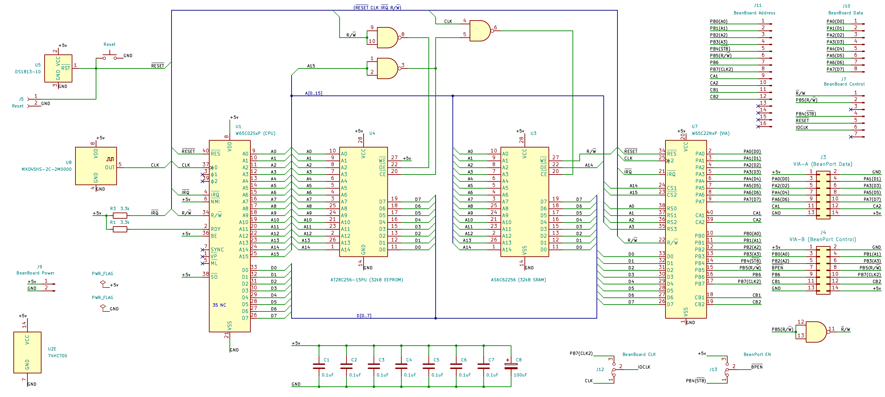
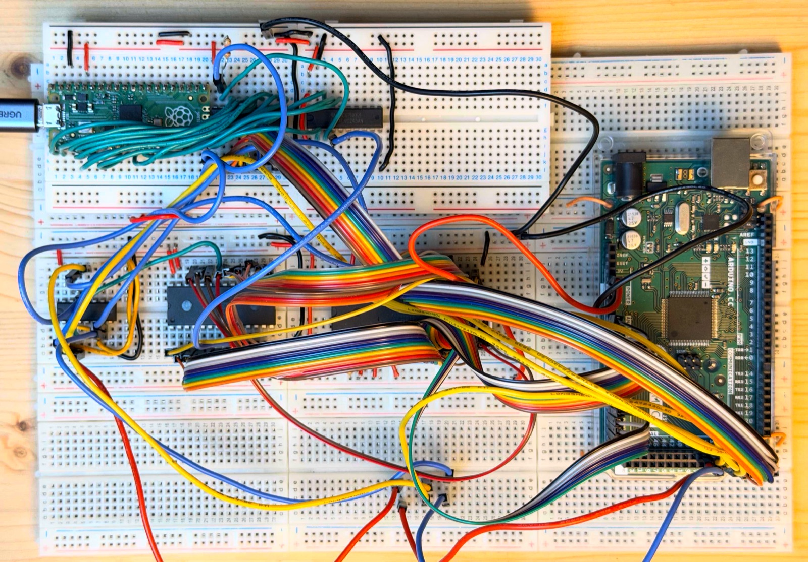
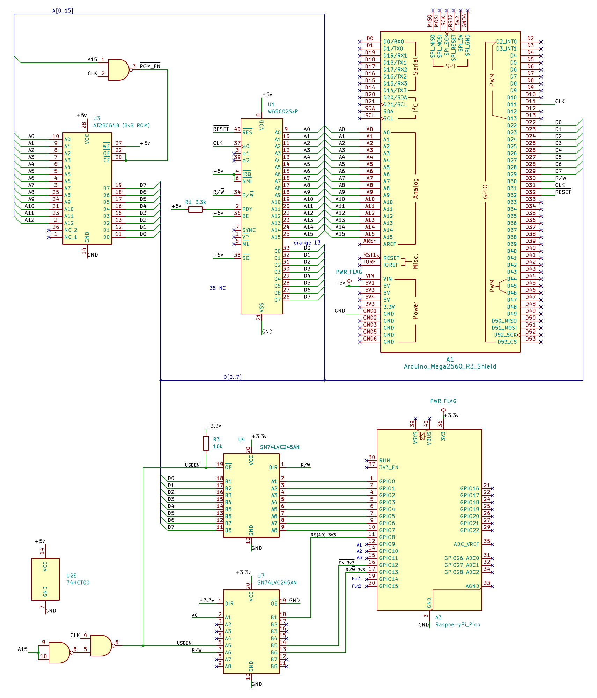

# Bean65

6502 homebrew computer that can take advantage of [BeanBoard](https://github.com/PainfulDiodes/BeanBoard)/[BeanBoardSPI](https://github.com/PainfulDiodes/BeanBoardSPI) peripherals which were originally designed for the Z80 [BeanZee](https://github.com/PainfulDiodes/BeanZee).

See also: [PainfulDiodes Blog: Bean65](https://painfuldiodes.wordpress.com/category/bean65/)

- W65C02S CPU
- 2MHz clock
- 32k ROM
- 16k RAM
- W65C22N VIA

## CPU Bus

The CPU bus touches only ROM, RAM and the VIA, decoded with a single 74HCT00 based on Garth Wilson's [simple ROM/RAM/VIA design](https://wilsonminesco.com/6502primer/potpourri.html): RAM at 0000-3FFF, the VIA at 4000-7FFF and ROM at 8000-FFFF.

Using a reset supervisor frees up one NAND, and dedicating the IO address range to a single VIA frees up a second. 

One of these is used to invert R/W# for the ROM's OE#, so the ROM only drives the bus on reads and a stray write to a ROM address can't cause bus contention.

The other helps meet BeanBoard's requirements (see below).

## Slow Bus / BeanBoard Interface

Every peripheral sits on a "slow bus" behind the VIA, under software control, allowing for slower devices to be connected (and 6502 dummy reads can't reach them).

The "slow bus" provides 6502-style signals - address and R/W#, with the addition of an I/O enable strobe.

This are made available through two 2x7 VIA Interface headers (in Garth Wilson's VIA connector format).

These also map economically onto BeanBoard's Z80-style bus: the strobe provides IORQ#, R/W# serves directly as WR#, and the one spare 74HCT00 gate inverts R/W# for RD#. Bean65 plugs into the BeanBoard's sockets.

## BeanPort

[BeanPort](https://github.com/PainfulDiodes/BeanPort) USB interface was designed so it can plug directly into Bean65's VIA connectors.

## Multi-mode

Bean65 was designed to cooperate with the existing BeanBoard and BeanBoardSPI peripherals. This required some compromises to the Bean65.

When neither BeanPort or BeanBoard are connected, with the Bean65 in standalone mode, the VIA connectors can serve as a general-purpose VIA connector.

If BeanPort is connected, the slow bus IO enable strobe is routed to BeanPort via a jumper - making it the only IO device attached to the Bean65.

When both BeanPort and BeanBoard are connected, the jumper is removed and BeanBoard decodes A1-A3 and provides its own IO enable strobe back to BeanPort, so that both BeanPort and BeanBoard share the slow bus. In this configuration the Bean65 has USB, keyboard and a small LCD display available. 

BeanBoardSPI can piggyback on BeanBoard and provide storage and replace the LCD display with a TFT panel display.

## Schematic

[kicad/bean65.pdf](kicad/bean65.pdf)

## Breadboard Prototype

The prototype has an Arduino Mega generating the clock and monitoring the bus, an 8k AT28C64B ROM, and BeanPort directly on the CPU bus (not yet behind the VIA):

[kicad_breadboard/bean65.pdf](kicad_breadboard/bean65.pdf)

## Links

- [Garth Wilson's 6502 primer](https://wilsonminesco.com/6502primer/)
- [BeanZee](https://github.com/PainfulDiodes/BeanZee)
- [BeanBoard](https://github.com/PainfulDiodes/BeanBoard)
- [BeanBoardSPI](https://github.com/PainfulDiodes/BeanBoardSPI)
- [BeanPort](https://github.com/PainfulDiodes/BeanPort)
